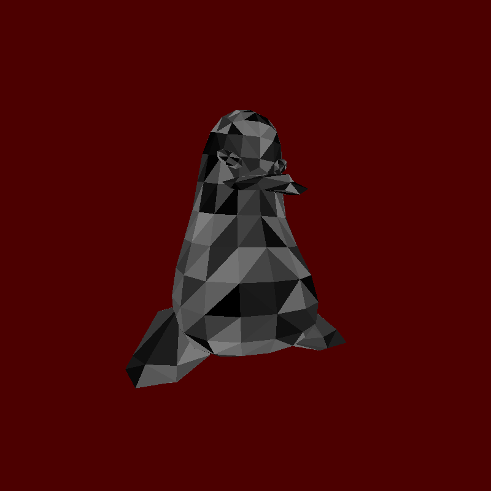
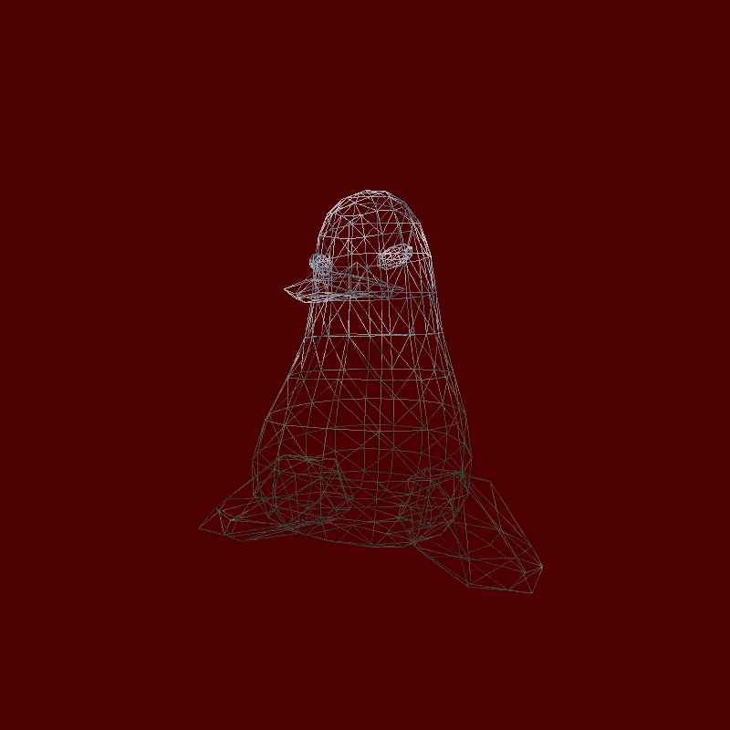
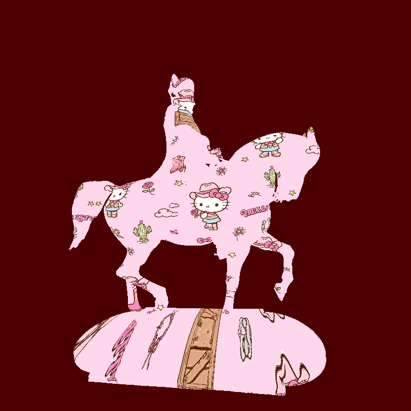

This project has been created as part of the 42 curriculum by maemaldo.

<h1>SCOP</h1>

 

<h2>Description</h2>

SCOP is a graphical project written in C++ and using OpenGL as a graphical API.
The goal of this project is to take a 3D object file in input, and display it on the screen. The object should be able to move and rotate in all 3 axis. The object should have a different color for each face, or texture.


<h2>Instructions</h2>

To compile and execute, simply use those commands:

```bash
make all # will install all dependencies and compile the source code
./SCOP
```
When program is launched, use the arrow keys, wasd, and ijkl keys to move and rotate the mesh around its 3 axis.

Move the camera with the mouse: drag with the left button to orbit around the object, and scroll to zoom in and out. Press R to reset the camera.

Press G to show the lines of the mesh, press F to return to faces. Press SPACE to alternate between texture and colors.

Press ESC to close the program.

<h2>Resources</h2>

- https://learnopengl.com/
- https://www.youtube.com/playlist?list=PLPaoO-vpZnumdcb4tZc4x5Q-v7CkrQ6M-
- https://www.ryanjuckett.com/parsing-colors-in-a-tga-file/


<h5>AI USAGE</h5>

AI (gemini by Google) was mostly used to help me understand the maths (matrices) and some complex opengl API/graphical notions. It was also occasionally used to help me debug code. No code was directly copy paste from the AI. This code is mine (written by me) and i understand it (or at least I did when writing it) perfectly.


<br><br><br><br><br>

here's Napoleon :

